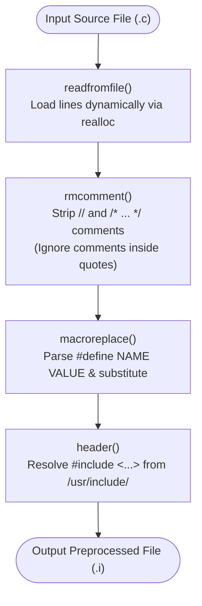

# ⚙️ Custom C Preprocessor (`cpp`) in C


-lightgrey)

A custom implementation of a **C Preprocessor** written from scratch in C. It simulates the first stage of the C compilation pipeline (`gcc -E`) by reading a raw `.c` source file, stripping single-line and multi-line comments, expanding `#define` object-like macros, resolving `#include <...>` system headers from `/usr/include/`, and generating a preprocessed `.i` output file.

---

## 🎯 Project Objectives
- **Understand Compilation Internals:** Implement the preprocessing phase of the C build pipeline using low-level file I/O and string manipulation.
- **Comment Removal:** Strip both single-line (`//`) and multi-line (`/* ... */`) comments while preserving string literals (`"..."`).
- **Macro Expansion:** Parse `#define` directives and substitute macro identifiers across subsequent lines of source code.
- **Header File Inclusion:** Locate `#include <header.h>` directives, fetch the corresponding header contents from `/usr/include/`, and merge them into the output translation unit.
- **Dynamic Memory Management:** Manage variable-length source files dynamically in memory using `realloc` and 2D character line buffers.

---

## 🔄 Preprocessing Pipeline & Architecture



---

## 🧩 Software Modules & Function Breakdown

The project is structured into modular functions handling each stage of preprocessing:

| Function / Module | File | Description |
| :--- | :--- | :--- |
| `main(int argc, char *argv[])` | `main.c` | Validates CLI arguments (`<input.c> <output.i>`) and orchestrates the preprocessing pipeline |
| `readfromfile(char *filename)` | `main.c` | Reads the input `.c` file line-by-line into a dynamically allocated `char (*lines)[100]` array using `fgets()` and `realloc()` |
| `rmcomment(char (*lines)[100])` | `main.c` | Scans characters while tracking double-quote states (`"..."`) to strip `//` comments and replace `/* ... */` blocks with spaces |
| `macroreplace(char (*lines)[100])` | `macro.c` | Extracts macro names and replacement values from `#define` lines and replaces occurrences in downstream code lines |
| `header(char (*lines)[100], char *filename)` | `header.c` | Extracts header filenames from `#include <...>`, copies `/usr/include/<header>` into the output `.i` file, and appends the processed source code |

---

## ⚙️ How It Works (Step-by-Step)

1. **File Loading (`readfromfile`):**
   - Opens the input `.c` file in read mode and allocates 100-byte line buffers dynamically as each line is read, tracking total line count in the global variable `cnt`.
2. **Comment Stripping (`rmcomment`):**
   - Iterates through every line while toggling a quote flag (`col`) whenever `"` is encountered so comment-like sequences inside string literals (e.g., `"http://..."`) are untouched.
   - Truncates single-line comments (`//`) to newline and blanks out single-line or multi-line block comments (`/* ... */`).
3. **Macro Substitution (`macroreplace`):**
   - Searches for `#define` directives, extracts the macro identifier (`take`) and replacement token (`exp`), and scans all subsequent lines (`i + 1` to `cnt - 1`) to substitute matching identifiers.
4. **Header Expansion (`header`):**
   - Parses `#include <...>` to extract the header filename, constructs `/usr/include/<header>`, copies its contents directly into the target `.i` file, and writes out the remaining preprocessed source lines while omitting the original `#include <...>` line.

---

## 🚀 Compilation & Usage

### 1. Compile the Project
Compile all source modules together using `gcc`:
```bash
gcc main.c header.c macro.c -o my_cpp
```

### 2. Run the Preprocessor
Pass an input `.c` source file and a target `.i` output filename:
```bash
./my_cpp sample.c sample.i
```

### 3. Example Input & Output

**Input (`sample.c`):**
```c
#include<stdio.h>
#define MAX 50

int main()
{
    // Initialize variable with macro
    int x = MAX;
    /* Print value
       to console */
    printf("Value: %d // not a comment\n", x);
    return 0;
}
```

**Preprocessed Output (`sample.i`):**
```c
/* Contents of /usr/include/stdio.h expanded at the top */
...
#define MAX 50

int main()
{
    
    int x = 50;
                  
                  
    printf("Value: %d // not a comment\n", x);
    return 0;
}
```

---

## ⚠️ Known Limitations & Edge Cases
- **Line Length Limit:** Fixed buffer size of `100` characters per line (`char (*lines)[100]`); lines exceeding 99 characters will split across array entries.
- **Single System Header:** `header()` currently resolves the last `#include <...>` directive encountered and does not support local quotes (`#include "file.h"`) or recursive nested includes.
- **Object-Like Macros Only:** `macroreplace()` handles single-token object-like macros (`#define PI 3.14`) and does not yet evaluate function-like macros (`#define SQR(x) ((x)*(x))`) or conditional compilation (`#ifdef`, `#ifndef`, `#endif`).
- **Token Boundary Matching:** Uses `strstr()` for macro matching, which may match substrings inside longer identifiers unless bounded by delimiters.

---

## 🛠️ Future Enhancements
- **Recursive Header Expansion:** Support multiple `#include <...>` and local `#include "..."` files recursively while guarding against circular inclusions.
- **Full Macro & Conditional Support:** Add support for parameterized function-like macros, `#undef`, `#ifdef` / `#ifndef` / `#else` / `#endif` blocks, and whole-word token matching.
- **Dynamic Line Lengths:** Replace fixed 100-byte line buffers with dynamically sized line pointers (`char **lines`) to handle arbitrarily long source lines safely.
- **Cleanup of `#define` Lines:** Strip processed `#define` directive lines from the final `.i` output file just like standard `cpp`.

---

## 📂 Repository Structure

```text
custom-c-preprocessor/
│
├── README.md
├── main.c          # CLI entry point, file reader, and comment stripper
├── header.c        # #include <...> resolution and .i file generation
└── macro.c         # #define parsing and macro replacement logic
```
